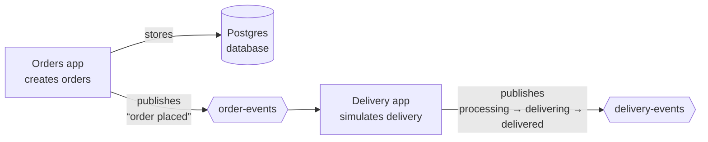
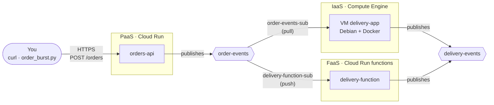

# EDEM – Máster en IA, Big Data & Cloud 26/27 · Cloud Intro

Hands-on labs for the **Cloud Intro** sessions (2 days × 4 h). In *GCP Project Setup* you prepared a Google Cloud project. Now we look at **why** the cloud exists and **what** it changes, using the same e-commerce business case:

- **Day 1:** first we run the whole shop on your laptop, the way a company would run it in its own server room ("on-premises"). Then we move it to the cloud in three different ways: a virtual machine, a managed platform and a function.
- **Day 2:** a Black Friday traffic burst, surviving failures across zones, comparing regions, SLAs and costs.

## The business case (recap)



| Piece | In plain words |
|---|---|
| **Orders app** | A program that pretends to be customers buying in our shop. |
| **Postgres** | The database: the shop's ledger where every order is written down. |
| **Message broker** (Pub/Sub) | A mailbox between programs. The orders app drops a note (“order 42 placed”); the delivery app picks it up when it can. |
| **Delivery app** | A program that takes each new order and simulates its delivery. |

## The shop in the cloud (after Lab 2)

In Lab 1 every box above is a container on your laptop. In Lab 2 we move the shop to Google Cloud, and each piece runs on a **different service model**:



| Service model | What runs there | What **you** look after | Lab |
|---|---|---|---|
| **IaaS** | `delivery-app` on a virtual machine (Lab 4: a group of VMs across zones) | OS, Docker, disk, scaling, patches | 2.1, 3, 4 |
| **PaaS** | `orders-api`, a container built from your source code | your code and a few settings | 2.2, 3, 4.4 |
| **FaaS** | `delivery-function`, called once per order | one function | 2.3, 3 |
| **SaaS** | nothing to deploy: Gmail, GitHub, Looker Studio… | only your data and settings | 2.4 |

Pub/Sub itself is a fully managed Google service: you create topics and subscriptions, Google runs everything else. Both delivery consumers receive every order on purpose, so you can compare them in Lab 3.

## Labs

| Day | # | Lab | Topics | Time |
|---|---|---|---|---|
| 1 | 1 | [On-prem in a box](labs/01-onprem-in-a-box.md) | What “on-premises” means, servers, failures, capacity | 50' |
| 1 | 2 | [One app, three service models](labs/02-service-models.md) | IaaS (VM), PaaS (Cloud Run), FaaS (Cloud Run functions), SaaS | 70' |
| 2 | 3 | [Black Friday](labs/03-black-friday.md) | Scalability vs elasticity, vertical vs horizontal, scale to zero | 45' |
| 2 | 4 | [Zones, regions and failures](labs/04-zones-regions.md) | Managed instance groups, self-healing, latency, data residency | 50' |
| 2 | 5 | [SLAs, costs and responsibilities](labs/05-sla-costs.md) | Composite availability, CAPEX vs OPEX, shared responsibility | 40' |

## Before the first session ⚠️

The on-prem lab downloads about **1.5 GB** of Docker images. Do it at home, not on the class Wi-Fi:

```bash
git clone https://github.com/frkroe/2627-gcp-cloud-intro.git && cd 2627-gcp-cloud-intro
docker compose -f onprem/compose.yml pull
docker compose -f onprem/compose.yml build
```

## Prerequisites

- **Docker Desktop** running.
- Your EDEM account (`name@edem.es`) and the project EDEM gave you (e.g. `edem-p17`), where you have the **Editor** role.
- The `gcloud` CLI logged in with that account (Project Setup Lab 0).
- `config.env`: create it from `config.env.example` and copy `ALIAS`, `PROJECT_ID` and `PROJECT_NUMBER` from your Project Setup `config.env`.

At the end of Project Setup you deleted everything. **Everyone** runs `./scripts/catch-up.sh` at the start of Lab 2 to recreate the topics, subscriptions, repository and image. You don't create any service accounts: the apps run as the default compute service account (`$SA_DEFAULT`).

## Repository layout

```text
.
├── config.env.example
├── labs/                    # step-by-step instructions
├── ecommerce/               # business case: orders_app, delivery_app (same code as Project Setup)
├── onprem/compose.yml       # Lab 1: the whole shop on your laptop
├── orders_api/              # Lab 2: HTTP API for new orders (runs on Cloud Run)
├── functions/delivery/      # Lab 2: delivery logic as a function
├── deploy/                  # VM startup script + compose file (from Project Setup)
└── scripts/
    ├── order_burst.py       # Lab 3: Black Friday traffic generator
    ├── availability.py      # Lab 5: SLA calculator
    └── catch-up.sh          # Lab 2: recreate Project Setup resources (everyone)
```

## Cleanup

Each lab ends with a cleanup step. At the end of day 2 you delete **everything** you created, as in Project Setup: the next GCP session is weeks away. See [Lab 5 – Final cleanup](labs/05-sla-costs.md#final-cleanup).
